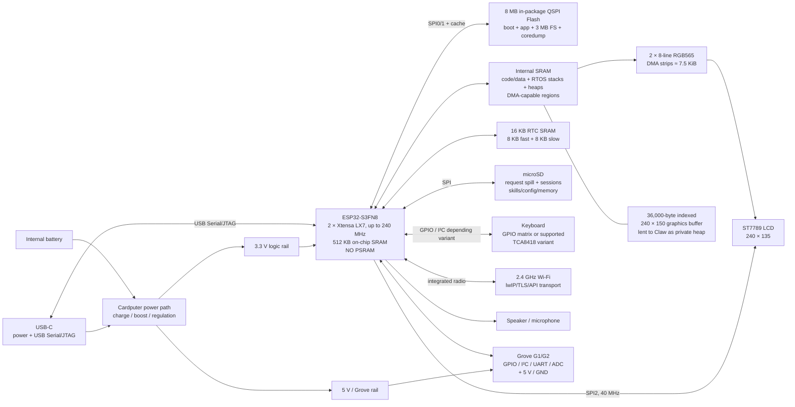
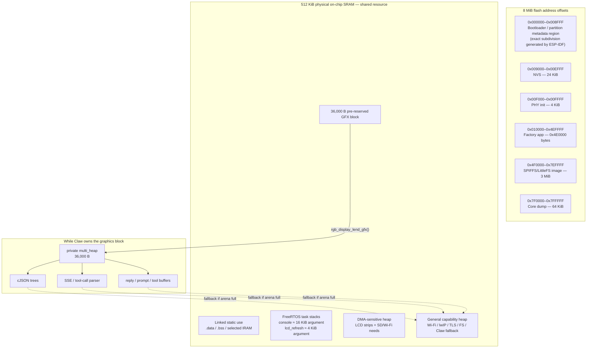
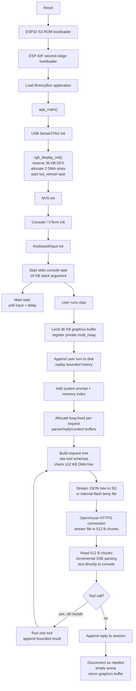

> Kept for reference (Felipe, 2026-10-12): an AI deep-research report on how BreezyBox `claw` fits a networked app
> into the stock Cardputer's PSRAM-less ESP32-S3FN8. Its `filecite`/`cite` markers are the research tool's internal
> references and do not resolve; treat every number in it as [UNVERIFIED]. Why it matters here: SPEC roadmap item 10
> (shim internal-RAM diet for heavily used no-PSRAM firmwares).

# BreezyBox Cardputer `claw` Without PSRAM: Architecture, Memory Engineering, Firmware Flow, and Builder Guidance

## Executive summary

The central fact is easy to miss: **`claw` is not running the language model on the Cardputer.** The model runs remotely; the ESP32-S3 locally implements the agent loop, HTTPS/SSE transport, bounded conversation replay, tool dispatch, persistent sessions/memories, Lua skill execution, and hardware access. The linked document explicitly describes this split. fileciteturn19file0L2-L2

The second crucial fact is that **PSRAM was not really “omitted” by the `claw` software designer**. The original M5Stack Cardputer is built around an M5StampS3 using an **ESP32-S3FN8**. M5Stack specifies 8 MB of flash for the device, and Espressif's chip table identifies the ESP32-S3FN8 as the 8 MB in-package-flash variant without in-package PSRAM. In other words, this port was engineered around a fixed hardware limitation of the stock Cardputer rather than choosing to save a PSRAM chip on a new board. citeturn4view0turn10view0

The design works without PSRAM principally by **never treating the remaining SRAM as one general-purpose bag of memory**. It reserves scarce contiguous resources early, separates DMA-sensitive storage from ordinary buffers, reuses buffers instead of repeatedly reallocating them, streams large data through storage/network interfaces, bounds conversation state, and deliberately measures **largest contiguous block** and **DMA-capable free memory**, rather than trusting total free heap. ESP-IDF itself warns that aggregate free heap does not imply that a block of that size can be allocated; `heap_caps_get_largest_free_block()` is the relevant fragmentation metric. fileciteturn27file0L2-L2 citeturn12search0

The most ingenious current optimization is **temporal multiplexing of a 36,000-byte graphics framebuffer**. The display reserves an 8-bit 240×150 graphics buffer very early in boot, while the internal heap is still contiguous. When `claw` starts, graphics *lends* that already-reserved block to `claw`; `claw_arena.c` registers it as a private ESP-IDF `multi_heap`, routes cJSON and several large transient allocations through it, and gives it back intact when the command exits. It is not returned to the general heap in between. fileciteturn26file0L2-L2 fileciteturn27file0L2-L2 fileciteturn31file0L2-L2

That change matters because an earlier implementation freed the 36 KB framebuffer and tried to reacquire it later. Although roughly 105 KB could remain free after a session, fragmentation left the largest block only about 31–34 KB, making graphics impossible until reboot. The current main-branch commit of October 1, 2026 records that the lending approach increased general free heap after request construction from roughly 20 KB to 55 KB with Wi-Fi and Bluetooth active, increased the minimum available DMA-capable memory from the 1.2–12 KB range to about 24 KB, and left roughly 65 KB after a round—enough to retain the HTTPS connection. fileciteturn42file0L2-L2

A second decisive choice was moving the **agent core from Lua to C while retaining Lua only as the skill runtime**. Measurements in the project's architecture log showed the Lua prototype consuming roughly 70 KB of real heap and, more importantly, collapsing the largest contiguous block from about 57 KB to only 7.7 KB. A TLS allocation could therefore fail despite approximately 27 KB of nominally free RAM. The C implementation avoids keeping a Lua VM resident through every HTTP request while preserving `run_lua` for generated skills. fileciteturn20file0L2-L2 fileciteturn29file0L2-L2

The third major technique is **streaming instead of materializing**. The JSON request is built as a bounded tree, serialized directly to `/sd/claw/tmp/req.json`—falling back to internal flash—and then sent in 512-byte chunks. Responses are processed one SSE event at a time and displayed as they arrive. Conversation replay defaults to only the newest 6,144 bytes, memories contribute only a 768-byte index, tool loops are capped, and large parser/tool buffers are allocated once and held rather than repeatedly freed and recreated. fileciteturn21file0L2-L2 fileciteturn38file0L2-L2 fileciteturn39file0L2-L2 fileciteturn41file0L2-L2

**Bottom line:** this is a good example of designing for *peak live working set and fragmentation*, not merely total RAM consumption. The system succeeds without PSRAM by trading some latency and implementation complexity for deterministic internal-memory survival: early reservation, memory lending, fixed/bounded buffers, streaming I/O, disk-backed request bodies, compact C code, capability-aware DMA allocations, and explicit low-memory admission checks. fileciteturn20file0L2-L2

## Source baseline, assumptions, and documentation inconsistencies

This analysis treats repository `main` at commit `0a168b28b255a90d852b823957af42303a8cda29`, dated October 1, 2026, as the authoritative software state. That matters because `docs/claw.md` and `docs/claw-architecture.md` preserve historical measurements and design decisions, including statements that were true during earlier memory experiments but were subsequently superseded by code. fileciteturn42file0L2-L2

The linked `claw.md` says the implementation is a clean-room agent inspired by Espressif's ESP-Claw, whose referenced implementation expects 8 MB of PSRAM; this Cardputer port instead keeps the model in the cloud and performs the control plane on-device. It also persists sessions, settings, memories, and generated Lua skills primarily on SD, falling back to `/root` in the firmware's internal flash filesystem when no card is present. fileciteturn19file0L2-L2

There is an important **stale-documentation trap**. One historical memory-budget passage says the `cardputer-claw` profile “skips” the 36 KB graphics framebuffer, and an old comment in `sdkconfig.defaults.cardputer-claw` says essentially the same thing. The current `rgb_display.c`, however, explicitly states that the buffer is now preallocated **on every profile, including the slim Claw profile**, because delaying allocation resulted in about 72 KB total free but only a 31,744-byte largest block—too fragmented to obtain the required 36 KB. The October 1 commit documents the subsequent lending mechanism. Therefore, for the current system, **“reserve then lend” supersedes “skip the framebuffer.”** fileciteturn22file0L2-L2 fileciteturn26file0L2-L2 fileciteturn42file0L2-L2

Similarly, the architecture document is intentionally partly historical: it records why the Lua prototype was replaced by a native C core and retains old measurements so the decision cannot easily be re-litigated. Those measurements are extremely valuable for understanding the engineering constraints, but the current source files take precedence where behavior changed afterward. fileciteturn20file0L2-L2

A second distinction is **normal firmware versus the dedicated slim profile**. The user-facing document describes `claw` as part of the broader BreezyBox firmware alongside shell, Bluetooth, SSH, and graphics, whereas `sdkconfig.defaults.cardputer-claw` is an especially RAM-conservative configuration that disables Bluetooth and pares down Wi-Fi/LwIP/TLS settings. The current framebuffer-lending mechanism also allows configurations with Wi-Fi and Bluetooth simultaneously to work substantially better than before, as demonstrated by the October 1 measurements. These should not be conflated into a claim that all Claw builds universally disable Bluetooth. fileciteturn19file0L2-L2 fileciteturn22file0L2-L2 fileciteturn42file0L2-L2

Where the repository does **not** establish something, I treat it as unspecified. In particular:

| Item | Status in this report |
|---|---|
| MCU | Specified: ESP32-S3FN8 via the stock Cardputer/M5StampS3 hardware. citeturn4view0turn10view0 |
| Internal SRAM | Specified by ESP32-S3 datasheet: 512 KB physical on-chip SRAM, with overlapping instruction/data mappings rather than independent additive pools. citeturn10view1 |
| Flash | Specified: 8 MB, with the repository's exact partition CSV. fileciteturn43file0L2-L2 |
| PSRAM | None on the ESP32-S3FN8 stock Cardputer configuration. citeturn10view0 |
| LCD | ST7789-family SPI LCD; repository uses ESP-IDF's ST7789 panel driver at 240×135. fileciteturn26file0L2-L2 |
| SD bus host | SD GPIO connections are documented by M5Stack, but I do not infer an unverified SPI-host number here. citeturn4view0 |
| Power-management IC part numbers | Not required by `claw` and treated as unspecified here; the Cardputer documentation establishes battery/USB and regulated rails but not all PMIC details used in this analysis. citeturn4view0 |
| Main-task stack size | Build-configurable ESP-IDF value; not inferred from the files inspected. ESP-IDF identifies it as `CONFIG_ESP_MAIN_TASK_STACK_SIZE`. citeturn12search5 |
| Claw-specific ISR | None observed in the Claw code path inspected; peripheral drivers and Wi-Fi have ESP-IDF-managed interrupt activity, but `claw` itself is task/console driven. fileciteturn33file0L2-L2 |

## Hardware architecture without PSRAM

The stock Cardputer combines the dual-core ESP32-S3 with internal flash, LCD, keyboard, microSD, audio, USB, battery power, and a Grove external interface. M5Stack identifies the processor as an ESP32-S3FN8 running up to 240 MHz with 8 MB flash, Wi-Fi, a 240×135 display, microSD, keyboard, audio and Grove interfaces. Espressif's datasheet identifies the FN8 variant as carrying 8 MB Quad-SPI flash but no integrated PSRAM. citeturn4view0turn10view0

The repository configures the Cardputer LCD on SPI2 at 40 MHz with MOSI GPIO35, SCLK GPIO36, CS GPIO37, D/C GPIO34, reset GPIO33 and backlight GPIO38. The backlight is PWM-controlled using LEDC. fileciteturn46file0L2-L2



The LCD implementation is itself a major no-PSRAM optimization. A complete 240×135 RGB565 framebuffer would be 64,800 bytes. The display driver therefore renders and transfers **eight scan lines at a time**, using two DMA-capable strip buffers so one can be filled while the other is associated with panel I/O. Each strip is `240 × 8 × 2 = 3,840` bytes; together they consume 7,680 bytes instead of 64,800 bytes of DMA-capable RAM. fileciteturn25file0L2-L2 fileciteturn26file0L2-L2

The separate 36,000-byte graphics buffer is not RGB565. It holds the 240×150 pixel graphics mode at one byte per indexed pixel; rendering converts indexed pixels to RGB565 a strip at a time. This distinction is important: **the big graphics allocation need not itself be DMA-capable**, while the two small transfer strips explicitly are allocated with `MALLOC_CAP_DMA | MALLOC_CAP_8BIT`. fileciteturn25file0L2-L2 fileciteturn26file0L2-L2

That matches Espressif's recommended model: peripheral DMA buffers should reside in suitable internal DRAM and be properly aligned, with `MALLOC_CAP_DMA` available for dynamic DMA allocation; stack DMA buffers are discouraged. citeturn12search1

Power also intersects with reliability. The linked Claw document warns that the Grove 5 V rail is shared with the board and high-current loads such as motors, relays, coils, or bright addressable LEDs can trigger the ESP32-S3 brownout detector. This is not a memory bug even if the symptom is a spontaneous reset; the documented workaround is USB power and, for substantial external loads, a separately powered accessory with common ground. fileciteturn19file0L2-L2

## Memory map and allocation strategy

The ESP32-S3 has 512 KB of physical on-chip SRAM. Its CPU address map exposes overlapping instruction- and data-side views of this SRAM; the datasheet shows a data-address window around `0x3FC8_8000–0x3FCF_FFFF` and an instruction-address window around `0x4037_0000–0x403D_FFFF`. These should **not** be added together as if they were separate physical memories. The same datasheet also exposes external cached address windows that can map flash or PSRAM; on the FN8 Cardputer there is no PSRAM populated behind an external-data PSRAM mapping. citeturn10view1turn10view2

### Logical memory picture



The flash partition map above comes directly from `partitions.csv`. NVS occupies 0x9000–0xEFFF, PHY data 0xF000–0xFFFF, the factory application 0x10000–0x4EFFFF, the 3 MB filesystem 0x4F0000–0x7EFFFF, and the final 64 KB is reserved for core dumps. fileciteturn43file0L2-L2 ESP-IDF's normal startup sequence is ROM first-stage boot, second-stage bootloader/partition selection, application startup, RTOS startup and ultimately `app_main()`. citeturn11search6

**Internal static use.** Ordinary `.data` and `.bss`, selected IRAM code/data, RTOS objects, drivers and protocol state consume internal memory before the dynamically available heap is considered. ESP-IDF's capability allocator manages several internal heap regions; `malloc()` ultimately uses this allocator. citeturn12search0

**Graphics reservation.** During `rgb_display_init()`, before the system has had time to fragment the heap, the firmware asks for 36,000 bytes with `MALLOC_CAP_8BIT`. The source comment records an experiment where delaying this allocation left 72,328 bytes free but only a 31,744-byte largest block. The system therefore deliberately “wastes” 36 KB early in the sense of making it unavailable to arbitrary allocations, because the alternative is eventually having plenty of aggregate free RAM but no usable 36 KB contiguous region. fileciteturn26file0L2-L2

**Private Claw arena.** `rgb_display_lend_gfx()` does not call `free()`. It marks the framebuffer lent and returns its address and size. `claw_arena_begin()` passes this exact memory range to `multi_heap_register()`, creating a private allocator. `claw_malloc()` tries that arena first and falls back to normal `malloc()` only if necessary. `claw_free()` determines whether an address belongs to the private framebuffer region and routes the free to the correct allocator. fileciteturn27file0L2-L2

The arena also installs cJSON allocation hooks, so transient JSON nodes naturally consume the “borrowed” graphics memory first. On shutdown, the code asks the private heap how many bytes remain allocated. Only an empty arena is returned to graphics; if an allocation leaked, the firmware deliberately leaves the framebuffer lent rather than allowing graphics to overwrite live agent data. fileciteturn27file0L2-L2 fileciteturn31file0L2-L2

**Stack usage.** The application starts the BreezyBox stdio/console machinery with a 16,384-byte stack argument, and Claw executes as a native console command in that context. The Claw source explicitly says its large SSE/tool-argument parser is placed on the heap because the console task's 16 KB stack cannot safely absorb it. The LCD refresh task is independently created with a 4,096-byte stack argument and priority 4, pinned to core 1. fileciteturn45file0L2-L2 fileciteturn26file0L2-L2 fileciteturn39file0L2-L2

ESP-IDF recommends measuring task stack high-water marks rather than blindly shrinking task stacks; an undersized task stack can manifest as seemingly unrelated corruption or crashes. citeturn12search4turn12search5

**DMA usage.** The LCD's two 3,840-byte strips are explicitly allocated from DMA-capable memory. SD/SPI and Wi-Fi activity also need scarce internal/DMA-capable memory. Consequently Claw checks `heap_caps_get_free_size(MALLOC_CAP_DMA)` immediately after constructing a request and refuses to proceed unless at least **12 KB** remains. This was added after configurations with only roughly 1.7 KB of DMA memory at that stage could fail inside the SPI/SD path. fileciteturn35file1L13-L24 fileciteturn34file0L21-L40

**Why total free heap is inadequate.** The project's Lua experiment is the clearest demonstration. Without the resident Lua environment, one measurement showed 97,500 bytes free with a 57,344-byte largest block; with Lua, 27,584 bytes were still nominally free but the largest block had collapsed to 7,680 bytes, and a TLS allocation failed. This is exactly why `claw stats` reports free, minimum and largest-block figures rather than a single number. fileciteturn20file0L2-L2 fileciteturn31file0L2-L2 ESP-IDF explicitly documents the same distinction: total free bytes may be fragmented, whereas `heap_caps_get_largest_free_block()` represents the largest currently satisfiable single allocation. citeturn12search0

**Major live allocations and controls** can be summarized as follows:

| Consumer | Strategy in current no-PSRAM design | Why it matters |
|---|---|---|
| Graphics | 36,000 B reserved at boot, then temporally lent to Claw | Prevents fragmentation from destroying the only graphics-sized contiguous block. fileciteturn26file0L2-L2 |
| LCD transfer | Two 3,840 B DMA strips | Avoids a 64,800 B full RGB565 DMA framebuffer. fileciteturn25file0L2-L2 |
| Claw transient objects | Private 36 KB `multi_heap`, then general-heap fallback | Isolates much of the agent's allocation churn from system/TLS/DMA heap. fileciteturn27file0L2-L2 |
| TLS | Dynamic buffers; slim config has 8,192 B inbound and 1,024 B outbound records | Reduces contiguous handshake/connection pressure compared with larger defaults. fileciteturn22file0L2-L2 |
| HTTP transport | 512-byte TX/RX client buffers; request streamed in 512-byte chunks | Keeps transport buffer cost bounded. fileciteturn38file0L2-L2 |
| Request JSON | Tree exists only while needed, then is serialized incrementally to SD/flash | Avoids a second large contiguous “printed JSON” allocation. fileciteturn38file0L2-L2 |
| Tool declarations | Printed early and represented as raw JSON rather than retaining full cJSON subtrees | Historical heap cost fell from ~23 KB tree form to ~5 KB raw-text form. fileciteturn20file0L2-L2 |
| Session history | Disk-backed JSONL, replay newest `context_budget` bytes; default 6,144 B | Long-lived conversations do not imply unbounded in-RAM history. fileciteturn21file0L2-L2 |
| Persistent memories | Only index injected by default, capped at 768 B | Full memories are fetched on demand. fileciteturn21file0L2-L2 |
| SSE/tool parser | Heap/arena, allocated once for the complete agent request | Avoids both stack overflow and reallocation failure after fragmentation-heavy Lua tools. fileciteturn39file0L2-L2 |
| HTTPS keep-alive | Retained only if ≥40 KB internal heap remains | Prevents connection reuse from starving the *next* command of memory. fileciteturn36file1L13-L24 |

## Firmware and software execution flow

The ESP-IDF boot path begins in mask ROM, loads the second-stage bootloader, selects and loads the application using the partition table, establishes cached flash mappings and RAM segments, starts the RTOS and second CPU, and ultimately enters `app_main()`. citeturn11search6

The firmware then does something particularly significant for a no-PSRAM system: **it initializes the display near the beginning of `app_main()`**. That causes the 36 KB graphics reservation and DMA strip allocations to happen before NVS, console activity, input handling, networking, Lua activity, and user commands have heavily fragmented dynamic memory. After display initialization it initializes NVS, the virtual terminal/console, input, command registration and the BreezyBox stdio task; the application's continuing main loop largely polls keyboard/input and sleeps. fileciteturn45file0L2-L2



The command path itself is synchronous from the user's perspective. `cmd_claw()` lends the graphics memory, activates the arena, calls the Claw command implementation and, on return, closes agent connection resources and attempts to return the arena to graphics. There is no resident always-running “AI task” continuously holding a model or context in RAM. fileciteturn31file0L2-L2

During `claw_agent_ask()`, the user turn is first appended to the on-disk session. Only the newest transcript bytes that fit `context_budget` are replayed. The firmware temporarily builds the system prompt and small memory index, allocates the reply/parser state, and enters a maximum eight-round agent/tool loop. fileciteturn21file0L2-L2 fileciteturn39file0L2-L2

For each HTTP round, tool declarations are constructed and flattened before the rest of the request reaches its memory peak. The backend request tree is then assembled largely using references instead of duplicating transcript strings. After construction, the firmware performs the 12 KB DMA-headroom check. fileciteturn20file0L2-L2 fileciteturn38file0L2-L2

The JSON serializer is deliberately not the standard cJSON “print the whole document into a growing buffer” path. The source notes that a roughly 12 KB document could otherwise lead to a roughly 32 KB contiguous request while the printer grows its destination buffer. Instead `claw_json_write_file()` walks the tree and writes progressively to SD or the flash fallback; once written, the request tree is deleted. fileciteturn38file0L2-L2

The resulting file is streamed through `esp_http_client` in **512-byte pieces**. Similarly, response data is read in 512-byte pieces and fed into an incremental SSE parser; decoded text is written straight to the console while only bounded reply state needed for session persistence is retained. This is the core reason the on-device RAM requirement is decoupled from the total HTTP body size. fileciteturn38file0L2-L2 fileciteturn41file0L2-L2

The agent permits one accumulated tool call per response round and then iterates. A maximum of eight tool rounds prevents an indefinitely expanding request, battery consumption and API expenditure. Tool output is bounded, and duplicate repeated calls are detected by hashing complete arguments. fileciteturn33file0L2-L2 fileciteturn39file0L2-L2

Connection reuse is another memory/performance balancing act. An open HTTPS connection costs roughly 12 KB plus client state according to the project's measurements, so the connection survives a round only when at least **40 KB** remains free. When it can be retained, the documented 10–12 KB Gemini-request measurements fall from roughly 840–1,050 ms for DNS/TCP/TLS/connect-and-send to roughly 120–145 ms on an already-established connection. fileciteturn21file0L2-L2 fileciteturn36file0L1-L9

**RTOS and interrupt behavior.** At application level, the Cardputer keyboard path is polled by the continuing main loop rather than having Claw process keys from an ISR. The display has a dedicated `lcd_refresh` FreeRTOS task, while panel transfer is handed to the ESP-IDF SPI/LCD machinery. Wi-Fi, USB, timers and peripheral drivers have their own ESP-IDF interrupt/task infrastructure, but there is no Claw-specific ISR or ISR-resident agent loop in the inspected source. fileciteturn45file0L2-L2 fileciteturn47file0L2-L2 fileciteturn26file0L2-L2

One small but telling detail is that the network receive loop calls `vTaskDelay(1)` periodically during long streaming activity so the idle task continues running and the task watchdog is not starved. fileciteturn38file0L2-L2

## Design choices, tradeoffs, and PSRAM comparison

The most important correction to the premise is that **the project is solving for a stock PSRAM-less board, not advocating PSRAM-less design as universally superior**. A new custom board intended primarily for a networked AI agent would have a strong argument for adding PSRAM. The current engineering is interesting precisely because the hardware cannot assume it. citeturn4view0turn10view0

Moving the agent from Lua to C demonstrates the real metric. Interpreter speed was *not* the principal issue: the project measured networking and LCD output as much larger latency contributors. The problem was peak RAM and allocator fragmentation. The Lua runtime used roughly 70 KB in practice and made TLS's need for contiguous memory unreliable. Keeping Lua only for episodic `run_lua` skills retains programmability without carrying that interpreter through every request. fileciteturn20file0L2-L2

Likewise, using a disk-backed request sounds slower than retaining everything in RAM, and it is: the document measures request construction/writing at roughly 200–270 ms for a 10–12 KB request. But that cost buys a dramatic reduction in peak contiguous RAM, and overall request latency is generally dominated by network/TLS/provider time anyway. fileciteturn21file0L2-L2

The framebuffer-sharing scheme introduces another explicit tradeoff: **pixel graphics and Claw cannot use the 36 KB block simultaneously**. While Claw owns it, entering a framebuffer-based graphics mode is rejected. Text-mode console output remains available because it uses the much smaller text/display pipeline. That is spatial scarcity converted into temporal exclusivity. fileciteturn21file0L2-L2 fileciteturn26file0L2-L2

A PSRAM-equipped ESP32-S3 can map external memory into the CPU data address space and add it to ESP-IDF's capability allocator using `MALLOC_CAP_SPIRAM`; ESP-IDF can also allow ordinary `malloc()` to consume external memory and can reserve an internal pool specifically for allocations that must remain internal, including DMA-sensitive ones. citeturn11search0turn11search1 External RAM is cached and is therefore not identical to on-chip SRAM; access behavior changes with cache locality and large working sets. citeturn11search0

| Dimension | Current Cardputer, no PSRAM | PSRAM-equipped redesign |
|---|---|---|
| Physical memory | 512 KB physical internal SRAM plus flash; no PSRAM on ESP32-S3FN8. citeturn10view0turn10view1 | Adds MB-scale cached external RAM to the ESP32-S3 address space. ESP-IDF supports allocating it through `MALLOC_CAP_SPIRAM`. citeturn11search0 |
| Agent working set | Must carefully bound, recycle and spill large objects. fileciteturn41file0L2-L2 | Large JSON, transcript/reply, model-tool metadata and graphics can preferentially occupy external RAM. citeturn11search0 |
| Fragmentation sensitivity | Very high; a large `free` value can coexist with an unusably small largest block. fileciteturn20file0L2-L2 | Internal heap remains important, but bulk allocations can be displaced into PSRAM and an internal reserve protected. citeturn11search1 |
| Display | 36 KB graphics memory is reserved early and lent to the agent; RGB565 output is strip-rendered. fileciteturn26file0L2-L2 | Indexed framebuffer is a natural candidate for PSRAM, while small transfer/DMA buffers remain internal. This is a recommended redesign, not current behavior. |
| JSON/request strategy | Disk-backed streaming avoids large contiguous prints. fileciteturn38file0L2-L2 | Still worth retaining for predictable memory, though PSRAM could permit more in-memory buffering. |
| TLS/network | Tight internal-memory margins motivate reduced buffers and keep-alive admission thresholds. fileciteturn22file0L2-L2 | Much more headroom for application allocations, but Wi-Fi/DMA/internal-critical pools should still be protected. ESP-IDF exposes an internal reserve specifically for this reason. citeturn11search1 |
| Task stacks | Internal RAM is scarce; large agent structures are deliberately kept off the console stack. fileciteturn39file0L2-L2 | ESP-IDF normally keeps task stacks internal; moving them externally has additional restrictions and should not be the first optimization. citeturn11search7 |
| Latency | Extra SD serialization costs hundreds of milliseconds, and low memory can force TLS reconnects. fileciteturn21file0L2-L2 | Some spill/reconnect overhead can potentially be eliminated, although external RAM is cached and not equivalent to zero-latency SRAM. citeturn11search0 |
| BOM/layout | No extra PSRAM is present on the stock module/board. citeturn10view0 | Requires a PSRAM-capable module/SiP or board-level high-speed memory design; Espressif recommends supported modules/SiPs or supported PSRAM parts. citeturn11search0 |
| Power/cost | No incremental PSRAM device is powered or purchased, but this is an inherited Cardputer property rather than a repository-measured saving. | Additional memory has BOM/power/layout consequences; the repository contains no measured before/after PSRAM power or cost data, so a numeric claim would be speculative. |
| Reliability | Fewer external-memory dependencies, but much greater sensitivity to internal fragmentation and SD spill paths. fileciteturn20file0L2-L2 | Less memory pressure, but introduces another cached high-speed memory subsystem and initialization/configuration dependency. citeturn11search0 |

The dedicated no-PSRAM/slim configuration applies additional pressure relief: it disables Bluetooth, reduces Wi-Fi buffer counts, disables IPv6 and Wi-Fi AMPDU in that profile, uses dynamic TLS buffers, limits inbound TLS records to 8,192 bytes and outbound records to 1,024 bytes, and enables TLS session tickets. These are targeted ways of reducing the amount and size of simultaneously live internal allocations. fileciteturn22file0L2-L2

The risk of such tuning is that “smaller” is not automatically “better.” For example, the repository notes that raising the outbound TLS record size to 4,096 bytes increased contiguous allocation demand and made handshakes fail on the fragmented prototype, while an inbound size that is *too* small could reject a server record that exceeds the configured capacity. The correct values are workload-dependent and should be benchmarked against actual providers rather than copied blindly. fileciteturn22file0L2-L2

## Builder and developer playbook

**For builders retaining the stock no-PSRAM Cardputer, preserve the design invariants before pursuing clever optimizations.** The most important invariant is that a memory optimization is not successful merely because `free heap` increased; it must preserve sufficient largest-contiguous and DMA-capable blocks at the point of maximum pressure. That principle is supported both by the project's failures and by ESP-IDF's allocator documentation. fileciteturn20file0L2-L2 citeturn12search0

A practical no-PSRAM allocation policy is:

```c
/* Ordinary agent data that must stay on-chip. */
void *p = heap_caps_malloc(
    size,
    MALLOC_CAP_INTERNAL | MALLOC_CAP_8BIT
);

/* SPI/LCD/other DMA-sensitive storage. */
void *dma = heap_caps_malloc(
    size,
    MALLOC_CAP_INTERNAL | MALLOC_CAP_DMA
);
```

ESP-IDF's capability allocator is specifically designed to distinguish such memory classes, and `MALLOC_CAP_DMA` is the supported mechanism for requesting dynamically allocated DMA-capable storage. citeturn12search0turn12search1

**Keep large DMA buffers out of transient task stacks.** The current LCD code correctly owns reusable DMA strips instead of sending a local framebuffer whose lifetime could expire while a transfer is in progress. Espressif similarly recommends static or capability-allocated DMA buffers rather than stack DMA buffers. fileciteturn25file0L2-L2 citeturn12search1

**Pool and reuse large objects.** Claw learned this experimentally with the SSE/tool-call parser: freeing a roughly 18 KB class of working state around a Lua tool and then reallocating it afterward could fail because the tool fragmented the heap. The current code holds the parser and related large state through the whole request instead. The general rule is that predictable reserved memory is often safer than theoretically lower average occupancy on a severely constrained heap. fileciteturn39file0L2-L2

**Stream at every boundary where full materialization adds no value.** The current sequence is the model to copy:

```text
bounded transcript
    ↓
cJSON structure
    ↓ incremental serializer
temporary request file
    ↓ 512-byte reads
TLS/HTTP
    ↓ 512-byte reads
incremental SSE parser
    ↓
console + bounded transcript reply
```

This keeps request and response byte counts from becoming equivalent to live RAM requirements. fileciteturn38file0L2-L2 fileciteturn41file0L2-L2

**Do not build large duplicate JSON representations.** Referencing strings/arrays already owned by the transcript and flattening tool schemas before the transcript tree reaches its peak reduced the project's request memory substantially. The architecture notes describe transcript/system-prompt live storage falling from roughly 32 KB copied to roughly 21 KB referenced, and the tool declaration representation from roughly 23 KB as a tree to roughly 5 KB as raw text. fileciteturn20file0L2-L2

**Use linker placement conservatively.** On ESP-IDF, ordinary executable code and constants normally benefit from flash/cache placement, while explicit IRAM/DRAM placement consumes the same scarce internal-memory budget needed by heap, stacks and DMA. Keep `IRAM_ATTR` for genuinely timing-critical or cache-disabled/ISR paths, avoid putting large constants into DRAM without a reason, and inspect the build's map/size output before and after every placement change. ESP-IDF describes internal IRAM/DRAM as the resources used for statically linked sections and the remaining regions as runtime heap; reducing static internal use therefore directly increases dynamic headroom. citeturn12search0

**Measure stacks instead of guessing.** Run representative Wi-Fi, SD, LCD, Claw and Lua-tool workloads and inspect `uxTaskGetStackHighWaterMark()` for application-created tasks before reducing a stack. ESP-IDF explicitly recommends this procedure and warns that over-shrinking stacks can produce unpredictable faults. citeturn12search4turn12search5

**For a PSRAM-equipped redesign, treat it as a hardware change, not a menuconfig switch on the stock Cardputer.** The stock ESP32-S3FN8 has no in-package PSRAM. A practical product-level solution is therefore a PSRAM-capable ESP32-S3 module/SiP or a board redesign with supported external PSRAM and the correct flash/PSRAM voltage and high-speed routing. ESP-IDF notes that ESP32-S3 PSRAM is connected alongside the flash interface and recommends supported Espressif memories/modules. citeturn10view0turn11search0

Once such hardware exists, the firmware can add `esp_psram` support and expose the memory to the capability allocator. Bulk allocations can then become explicit:

```c
void *bulk = heap_caps_malloc(
    size,
    MALLOC_CAP_SPIRAM | MALLOC_CAP_8BIT
);

/* Continue protecting internal/DMA memory explicitly. */
void *dma = heap_caps_malloc(
    dma_size,
    MALLOC_CAP_INTERNAL | MALLOC_CAP_DMA
);
```

ESP-IDF 5.5 supports both explicit `MALLOC_CAP_SPIRAM` allocation and policies that make PSRAM available to ordinary `malloc()`. It also provides `CONFIG_SPIRAM_MALLOC_ALWAYSINTERNAL` for internal/external allocation preference and `CONFIG_SPIRAM_MALLOC_RESERVE_INTERNAL` to maintain an internal pool for allocations such as DMA. citeturn11search0turn11search1

For this particular codebase, the safest order for PSRAM migration would be to move **bulk, non-DMA, non-ISR objects first**: the 36 KB indexed graphics framebuffer, large cJSON/request structures, reply/tool buffers, transcript/prompt working storage and perhaps some caches. Keep LCD DMA strips, Wi-Fi/driver-critical storage and small latency-sensitive synchronization objects internal. This recommendation follows the current separation of graphics backing storage from the internal DMA strips and ESP-IDF's explicit internal-reserve mechanism. fileciteturn26file0L2-L2 citeturn11search1

I would **not initially move FreeRTOS stacks to PSRAM**. ESP-IDF 5.5 normally keeps task stacks internal and warns that external memory has restrictions around cache-disabled flash operations; external stack placement is possible only with additional configuration and constraints. Recovering bulk-buffer SRAM gives most of the benefit with considerably less failure surface. citeturn11search7

### Recommended validation matrix

A rigorous benchmark should record at least these figures at cold boot, before Claw, after request construction, during TLS, after every tool, after the final round, and after graphics is reacquired:

```c
const uint32_t internal = MALLOC_CAP_INTERNAL | MALLOC_CAP_8BIT;

printf("internal free=%u largest=%u min=%u dma=%u\n",
       (unsigned)heap_caps_get_free_size(internal),
       (unsigned)heap_caps_get_largest_free_block(internal),
       (unsigned)heap_caps_get_minimum_free_size(internal),
       (unsigned)heap_caps_get_free_size(MALLOC_CAP_DMA));
```

Those APIs are precisely the ESP-IDF mechanisms for distinguishing aggregate free memory, lifetime low-water mark and largest satisfiable allocation. citeturn12search0 The existing `claw ask -v` and `claw stats` already expose several of the same measurements, so instrumentation can build on the firmware rather than starting from scratch. fileciteturn21file0L2-L2 fileciteturn31file0L2-L2

The most useful regression suite is not merely “does one prompt work?” It should include repeated graphics → Claw → graphics cycles; a session at the configured 6,144-byte context limit; many short history turns to stress cJSON node overhead; the eight-tool-round maximum; a Lua tool between model rounds; SD present and absent; fresh and reused TLS connections; normal versus slim configuration; Wi-Fi plus any optional Bluetooth configuration; and repeated connect/disconnect cycles. These cases directly exercise the failure modes documented by the project: framebuffer reacquisition, node-count overhead, growing tool rounds, Lua-induced fragmentation, request spill, connection memory, and concurrent network pressure. fileciteturn20file0L2-L2 fileciteturn21file0L2-L2 fileciteturn42file0L2-L2

For performance, preserve Claw's existing decomposition of **build**, **connect/reused-send**, **first byte**, and **stream** time. A change that saves 20 KB but forces every connection to be torn down could cost roughly 800 ms per subsequent round on the repository's measured Gemini workload; conversely, spending memory on keep-alive is only a win if it does not starve SD/Wi-Fi on the next prompt. fileciteturn21file0L2-L2

### Common pitfalls

| Pitfall | Why it fails | Correct strategy |
|---|---|---|
| Watching only “free heap” | Fragmentation can leave tens of KB free but no block large enough for TLS/framebuffer allocation. fileciteturn20file0L2-L2 | Track free, minimum, **largest block**, and DMA free. citeturn12search0 |
| Freeing the 36 KB framebuffer to “save RAM” | Other allocations occupy the hole and graphics cannot later recover a contiguous 36 KB block. fileciteturn42file0L2-L2 | Reserve early and lend it as an isolated `multi_heap`. |
| Full-screen RGB565 LCD buffering | Would consume 64.8 KB, much of it with DMA requirements. fileciteturn25file0L2-L2 | Render into two eight-line internal DMA strips. |
| Large parser/tool arrays on the console stack | The command already runs on a constrained task stack. fileciteturn39file0L2-L2 | Heap/arena allocate bounded large objects and measure stack watermarks. |
| Allocating/freeing large buffers every tool round | A Lua tool can fragment the heap sufficiently that the next identical allocation fails. fileciteturn39file0L2-L2 | Allocate once for the whole request and reuse. |
| Printing the entire cJSON request to RAM | Growing serializer buffers require a large contiguous allocation at the worst possible time. fileciteturn38file0L2-L2 | Incrementally serialize directly to storage. |
| Unbounded transcript replay | Conversation duration becomes RAM pressure and request latency. fileciteturn21file0L2-L2 | Bound replay in bytes, not merely turns. |
| Overlarge TLS buffers | Larger record buffers increase contiguous allocation pressure; this project experimentally saw that failure mode. fileciteturn22file0L2-L2 | Size against actual servers and use dynamic buffers. |
| Assuming PSRAM makes capability constraints disappear | Some memory must still remain internal, and external RAM has cache/flash-operation restrictions. citeturn11search0turn11search1 | Reserve internal memory and use explicit allocation capabilities. |
| Moving all task stacks to PSRAM first | External-stack use has extra constraints and is not ESP-IDF's conservative default. citeturn11search7 | Move large noncritical data first; keep stacks internal initially. |
| Treating a Grove-induced reset as an allocator crash | High-current external loads can brown out the shared supply. fileciteturn19file0L2-L2 | Reproduce on USB and separately power heavy accessories before investigating software memory. |
| Following the old “skip graphics buffer” comment | That optimization was explicitly reversed in current code. fileciteturn26file0L2-L2 | Follow current source and the October 1, 2026 commit: preallocate, then lend. fileciteturn42file0L2-L2 |

The broad design lesson is that the Cardputer implementation does **not** replace PSRAM with one magic optimization. It replaces it with a coordinated memory architecture: C instead of a permanently resident Lua agent, bounded state, disk-backed streaming, early contiguous reservations, a private temporary heap, DMA-specific pools, reduced full-frame buffering, dynamically sized TLS resources, conservative Wi-Fi configuration, explicit admission thresholds and continuous heap telemetry. Removing any single one may appear harmless in an idle-memory snapshot while reintroducing failure at peak concurrency. fileciteturn20file0L2-L2 fileciteturn22file0L2-L2

The remaining open limitation is hardware-specific PSRAM retrofit detail. The sources establish that the stock Cardputer's ESP32-S3FN8 lacks PSRAM and that ESP32-S3 supports external PSRAM generally, but they do not establish a supported drop-in PSRAM retrofit for the existing M5StampS3/Cardputer PCB. Therefore a serious “add PSRAM” build should be treated as a **module/PCB redesign until pin availability, signal routing, power voltage, boot strapping and mechanical compatibility are verified against the exact replacement module and Cardputer schematic**. citeturn10view0turn11search0